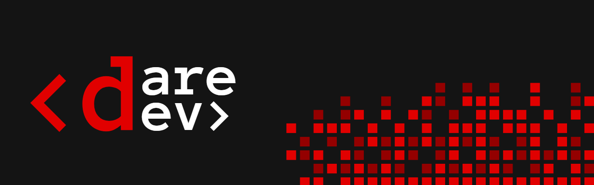

<html lang="pt-br">
<body>

A DareDev é uma equipe formada por estudantes do Curso Superior de Tecnologia em Banco de Dados da Fatec São José dos Campos, dedicada ao desenvolvimento das APIs (Aprendizagem por Projetos Integradores).

## Projetos 

Esta seção apresenta os projetos desenvolvidos pela equipe ao longo dos semestres, descrevendo seus objetivos:

Nome | Semestre | Sobre
--- | --- | ---
[**Medshift**](https://github.com/DareDev07/API-MedShift) | **1º SEM** | O MedShift auxilia os colaboradores do Hospital Aurora na criação e validação de escalas médicas, substituindo o processo manual por uma solução digital mais rápida, organizada e confiável, que reduz conflitos de horário e erros operacionais.

## Integrantes da equipe DareDev

A equipe DareDev é composta pelos seguintes integrantes, que colaboram no planejamento, desenvolvimento e execução dos projetos integradores ao longo da graduação:

<table align="center">
  <tr>
    <td align="center" width="140">
       
      Agatha Santana
    </td>
    <td align="center" width="140">
       
      Ana Júlia
    </td>
    <td align="center" width="140">
       
      Bianca Miranda
    </td>
    <td align="center" width="140">
       
      Clara Teixeira
    </td>
    <td align="center" width="140">
       
      Gabriel Reis
    </td>
    <td align="center" width="140">
       
      Nicolly Vitória
    </td>
  </tr>
  <tr>
  <td align="center">
    
  </td>
  <td align="center">
    
  </td>
  <td align="center">
    
  </td>
  <td align="center">
    
  </td>
  <td align="center">
    
  </td>
  <td align="center">
    
  </td>
</tr>
</table>

#

</body>
</html>
